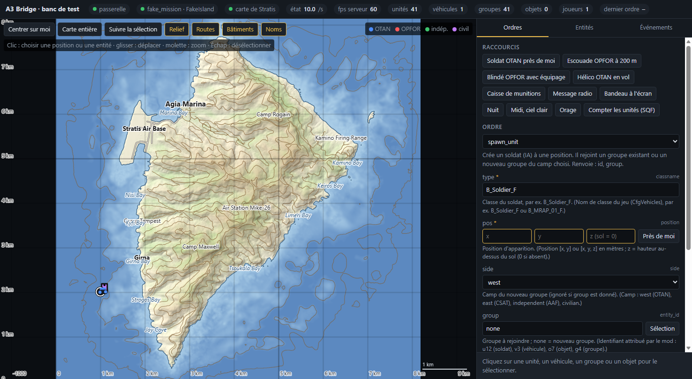
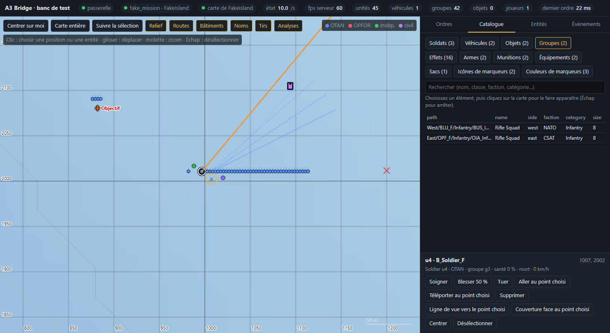
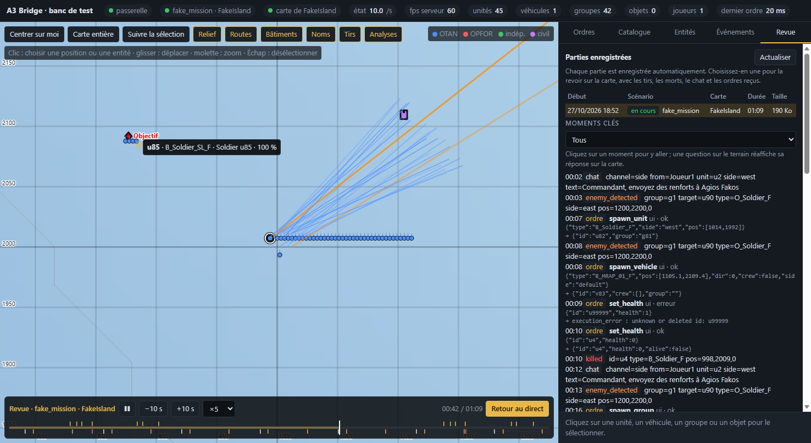

# A3 Bridge

Mod Arma 3 qui relie une partie en cours à un programme externe — par exemple un LLM comme Claude :

- **le jeu publie son état** (unités, véhicules, groupes, objets, marqueurs, météo) 10 fois par seconde, et ses
  **événements** au fil de l'eau (morts, tirs, ennemis repérés, passages en combat, chat des joueurs...) ;
- **il exécute des ordres** venus de l'extérieur : faire apparaître soldats, véhicules, groupes, effets et marqueurs,
  donner des ordres tactiques, et poser des **questions** sur le terrain (ligne de vue, couverture, ennemis connus...).

Tout passe par une passerelle locale (`127.0.0.1:8765`, HTTP + WebSocket), une page web de test et un serveur MCP
qui expose le tout à Claude.



## Ce que contient le dépôt

| Dossier | Contenu |
|---|---|
| `design/` | **Les tableaux de conception** (JSON, une ligne par élément) : ordres et paramètres, types, champs du flux d'état, événements, effets, catalogue, réglages. Tout le reste en est généré. |
| `src/sqf/` | Scripts du jeu écrits à la main : fonctions de base (`core/`) et corps des ordres (`commands/`). |
| `src/ui/` | La page web de test (un seul fichier, sans dépendance). |
| `ext/` | L'extension native en Rust (`a3_bridge_x64.dll`) : passerelle HTTP/WebSocket, file d'ordres, conversion SQF ⇄ JSON, cartes et catalogue. |
| `mcp/` | Le serveur MCP (Node, sans dépendance) pour piloter le jeu depuis Claude. |
| `tools/` | `build.py` (vérifie les tableaux, génère, compile, emballe) et `pbo.py` (format d'archive d'Arma). |
| `tests/` | Tests sans le jeu (faux scénario qui charge la vraie DLL) et tests sur le vrai moteur. |
| `docs/` | `PROTOCOL.md` et `llm_tools.json`, générés depuis les tableaux. |

## Construire le mod

Prérequis (Windows) :

- **Rust** avec la chaîne GNU, sans Visual Studio :
  `rustup-init.exe -y --default-host x86_64-pc-windows-gnu --profile minimal`
  (le fichier `ext/.cargo/config.toml` règle un détail de compilation propre à cette chaîne) ;
- **Python 3.11+** (bibliothèque standard uniquement) ;
- **Node 22+** pour le serveur MCP et les tests.

```
python -I tools/build.py
```

Le script vérifie d'abord les tableaux (aucune case vide, aucune référence cassée entre tableaux, scripts et page web),
génère les scripts du jeu, la configuration, la spécification et la documentation, compile la DLL puis emballe le mod
dans `dist/@a3_bridge`. Options : `--dist <dossier>` pour construire ailleurs (le mod est verrouillé tant qu'un jeu
l'utilise), `--ui-only` pour ne mettre à jour que la page web (même pendant une partie), `--no-cargo` pour s'arrêter
avant la compilation.

## Utiliser le mod

- **Solo** : lancer Arma 3 **sans BattlEye** avec `@a3_bridge` comme mod local (launcher) ou `-mod=<chemin>\@a3_bridge`.
- **Serveur dédié** : `-serverMod=<chemin>\@a3_bridge` ; les joueurs n'ont rien à installer.
  Sur un même PC avec l'installation « Arma 3 Server » de Steam, lancer **d'abord le jeu, puis le serveur** :
  Steam prend ce serveur pour le jeu et le ferme sinon.
- **Réglages** : copier `a3_bridge.example.json` en `a3_bridge.json` à côté de la DLL (port, fréquence du flux,
  événements de tir, export de carte et de catalogue...).
- **Journal** : `%LOCALAPPDATA%\Arma 3\a3_bridge.log`.

Le mod fonctionne avec n'importe quel scénario, officiel ou non. `tests/live/` contient une petite mission de test
(Stratis, 2 places avec Zeus) et deux configurations de serveur d'exemple.

### Page web de test

`http://127.0.0.1:8765/ui` pendant une partie : carte en direct sur le fond de la carte jouée (relief, routes,
bâtiments, noms, construit par le jeu à la première partie puis mis en cache), formulaires pour chaque ordre,
catalogue avec placement au clic, entités, événements, couches **Tirs** (traçantes) et **Analyses** (résultats des
questions sur la carte).



### Revoir une partie

Chaque partie est enregistrée automatiquement dans `%LOCALAPPDATA%\Arma 3\a3_bridge_replays` (une image par seconde
qui ne garde que ce qui a bougé, plus les événements et les ordres reçus avec leur provenance : page web, MCP...).
L'onglet **Revue** de la page les liste ; en choisir une la rejoue sur la carte avec une barre de lecture (×1 à ×60,
frise des moments clés, glisser pour se déplacer, Espace pour lecture/pause). La liste des moments clés (morts, chat,
repérages, ordres reçus avec leurs arguments et la réponse du jeu) permet de voir ce que l'IA a décidé et quand ; une
question sur le terrain y réaffiche sa réponse sur la carte. « Retour au direct » revient à la partie en cours.
Réglages : `replay_record`, `replay_interval_ms`, `replay_max_files` (50 parties gardées par défaut).



### Piloter le jeu avec Claude (MCP)

`mcp/arma_mcp.mjs` expose tous les ordres comme outils, plus des outils de lecture : situation filtrée par zone ou
par camp, événements, attente du chat ou d'événements choisis, recherche dans le catalogue. Il fournit aussi un prompt
`commandant_ia` : Claude répond aux joueurs dans le chat et dirige un camp.

```
claude mcp add arma -- node <chemin>/mcp/arma_mcp.mjs
```

Claude Desktop (`claude_desktop_config.json`) :

```json
{ "mcpServers": { "arma": { "command": "node", "args": ["<chemin>/mcp/arma_mcp.mjs"] } } }
```

### API

- `POST /command` avec `{"cmd": "spawn_unit", "args": {...}}`, ou en WebSocket `{"type": "command", "id": ..., "cmd": ..., "args": {...}}`
- `GET /state`, `GET /events?since=N`, `GET /health`, `GET /catalog`, `GET /map/<monde>`, `GET /replays`,
  `GET /replays/<id>`, `GET /schema`, `GET /spec`
- WebSocket `ws://127.0.0.1:8765/` : état et événements en continu

Le détail de chaque ordre, champ, événement et réglage est dans [docs/PROTOCOL.md](docs/PROTOCOL.md).

## Comment ça marche

- La DLL est chargée par le moteur via `callExtension`, la seule voie officielle vers l'extérieur. Elle ouvre la
  passerelle dans ses propres fils d'exécution.
- Côté jeu (`A3B_fnc_tick`, à chaque image) : le mod récupère les ordres en attente, les exécute (scripts générés
  depuis les tableaux, erreurs attrapées et renvoyées), envoie les événements et, toutes les 100 ms, une photo de
  l'état (environ 6,6 ms de calcul pour 125 unités).
- Certains événements ne se déclenchent que chez les joueurs (chat, tirs des joueurs) : le serveur installe un petit
  relais dans le jeu de chacun par `remoteExec`.
- Le fond de carte et le catalogue sont lus par le jeu lui-même au démarrage (relief, routes, bâtiments, classes
  plaçables, DLC et mods compris).

## Ajouter un ordre

1. Ajouter une ligne dans `design/commands.json` et ses paramètres dans `design/command_params.json`.
2. Écrire son corps dans `src/sqf/commands/<nom>.sqf` (paramètres disponibles en `_<nom>`, renvoyer un tableau de
   valeurs dans l'ordre de la colonne `returns`, `throw "message"` en cas d'erreur).
3. `python -I tools/build.py` : le validateur signale tout oubli (paramètre jamais utilisé, type inconnu...), la page
   web, la documentation et les outils MCP se mettent à jour d'eux-mêmes.

## Tests

- `python -I tests/fake_game.py` : charge la vraie DLL comme le moteur et joue un faux scénario ; vérifie la
  passerelle, les erreurs, la sécurité, la carte et le catalogue. `--serve` le laisse tourner (port 8799).
- Avec le faux scénario lancé : `node tests/mcp_test.mjs 8799` et
  `node tests/ui_test.mjs 8799 "<chemin de msedge.exe>" tests/ui_shots` (page web dans Edge invisible).
- Sur le vrai moteur (partie lancée avec le mod) : `tests/live_test.mjs`, `live_spawn_test.mjs`,
  `live_tactics_test.mjs`, `live_perception_test.mjs`, `live_chat_test.mjs`, `mcp_test.mjs <port> --live`.

## Limites et sécurité

- La passerelle n'écoute que `127.0.0.1` et refuse les requêtes venant d'autres sites web, mais **tout programme
  local peut piloter la partie**, y compris `exec_sqf`, qui exécute du code libre. À n'utiliser que sur une machine
  de confiance.
- BattlEye doit être désactivé là où la DLL est chargée (elle n'est pas signée).
- Si un scénario restreint `remoteExec` (`CfgRemoteExec`), le relais du chat et des tirs des joueurs ne peut pas
  s'installer.
- Le moteur limite les groupes à 288 par camp ; `str` arrondit les nombres à 6 chiffres significatifs (≈ 10 cm sur
  Altis).

## Licence

MIT — voir [LICENSE](LICENSE).
